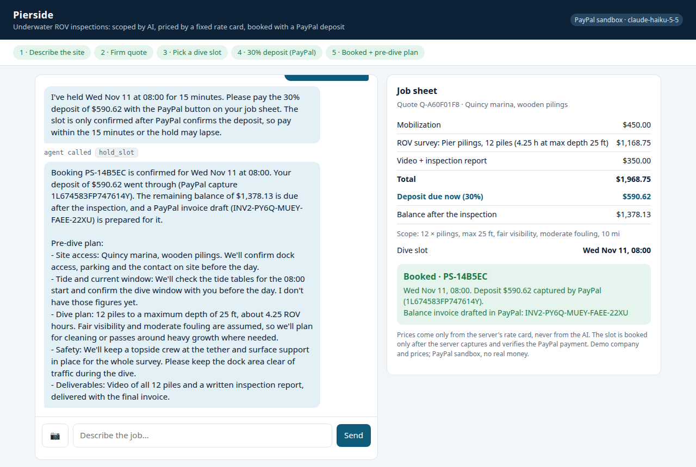
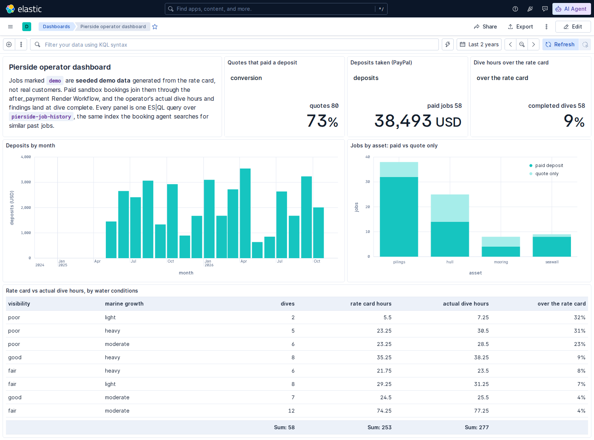
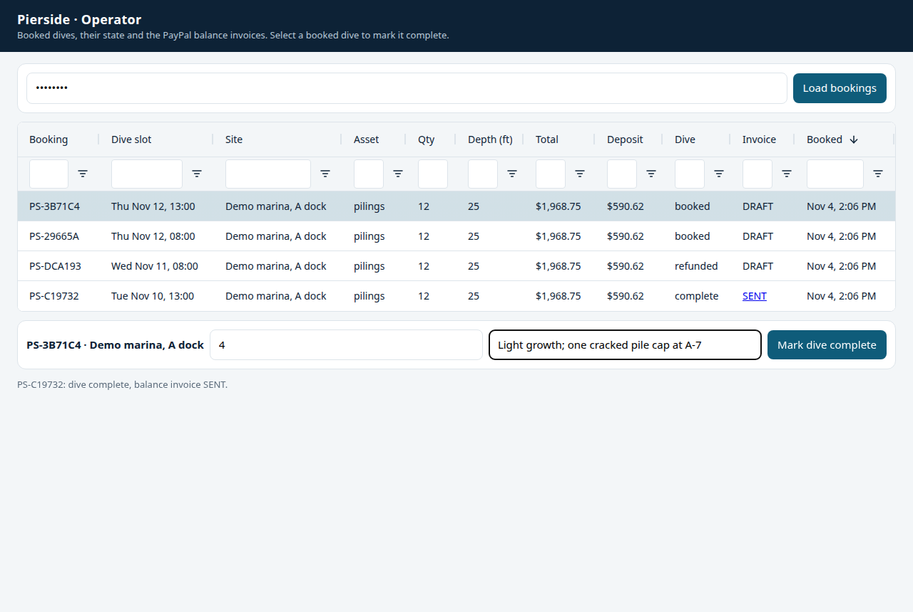

# Pierside

[](https://github.com/thiagopari/pierside/actions/workflows/api-tests.yml)

**An AI agent that scopes an underwater ROV inspection, prices it from a fixed rate card, takes a 30% deposit through PayPal, and books the dive slot. All in one conversation.**

Booking a dock, piling, seawall or hull inspection today takes days of phone tag. The contractor needs a dozen details (asset, size, depth, visibility, marine growth, distance), sends a quote by email, then chases a deposit before committing a crew and an ROV to a date. Pierside does that in about two minutes. A customer describes the site (or sends a photo), Claude asks the follow-up questions, a deterministic rate card produces the quote, and PayPal checkout takes the deposit. The slot is booked only after the server has verified the payment.



## Try it

- **Hosted demo:** https://pierside.onrender.com (Render free tier: the first load after idle takes about a minute)
- **PayPal sandbox buyer:** `sb-omnq353715140@personal.example.com` / `xN8%EHX2` (fake money, PayPal sandbox only)

Try: "12 wooden pilings at our marina in Quincy, about 25 ft deep", answer the agent's questions, pick a slot, then pay the deposit with the sandbox buyer.

## For judges

| Criterion | Where to look |
|---|---|
| Technological implementation | [How PayPal and AI are used](#how-paypal-and-ai-are-used): PayPal Orders v2 + JS SDK, verified webhooks and Invoicing v2; Claude tool use with strict schemas; Render Workflows; Elasticsearch. The [tests](#tests), including a [Postman collection](postman/pierside.postman_collection.json) with negative cases, run on every push in [GitHub Actions](https://github.com/thiagopari/pierside/actions/workflows/api-tests.yml) |
| Design | One conversation from the first message to a booked dive: [screens](docs/screens) of the chat, the live job sheet, PayPal checkout, the booking card and the phone layout. The operator side is there too: on the [operator page](#operator-page) (`/ops`, an AG Grid of every booking) marking a dive complete sends the balance invoice, a refund releases the slot, and the [Kibana dashboard](#elastic-similar-past-jobs-and-the-operator-dashboard) compares real dives with the rate card |
| Potential impact | For contractors who inspect docks, pilings, seawalls and hulls, and the marinas and owners who hire them. It replaces the days of phone tag between the first call and a deposit (top of this page). Demonstrated: scope, price, verified deposit and booked slot in one chat, then the balance invoiced after the dive |
| Innovation | The model talks; money moves only through deterministic, verified code. Folder 4 of the Postman collection tests it: with `MOCK=1` a scripted model plays a prompt-injected agent that asks `price_quote` for 50% off and grabs a rush slot at the normal price, and the server keeps the rate-card price and refuses the slot. Similar past jobs (Elastic hybrid search) inform the agent's notes and never change the price |
| Presentation | Video: link coming. [Hosted demo](https://pierside.onrender.com) with the sandbox buyer above |

## How PayPal and AI are used

| Step | Who does it | How |
|---|---|---|
| Scope the job | Claude (`claude-haiku-5-5`) | Multi-turn chat. Asks for missing facts and states its assumptions. With a site photo, Claude vision estimates marine growth and water clarity |
| Price it | Server code ([`pricing.py`](pricing.py)) | The agent calls the strict-schema tool `price_quote`. **The model never produces a number**: it can only repeat the rate card's output |
| Pick a slot | Claude + server | Tools `list_slots` / `hold_slot` (15-min hold). The server refuses rush slots unless the quote includes the rush surcharge |
| Take the deposit | PayPal **Orders v2** + **JS SDK** buttons | The server creates the order for exactly 30% of the quote (idempotent `PayPal-Request-Id`). The buyer approves in the PayPal popup |
| Book it | Server code | Captures the order, then checks that the status is `COMPLETED` and the amount equals the deposit. Only then does it book the slot |
| Balance | PayPal **Invoicing v2** | Drafts an invoice for the remaining 70%, with the deposit shown as paid. When the operator marks the dive complete, PayPal emails it to the customer and the job sheet links to the pay page |
| Follow-up | Claude | Gets a server-generated PAYMENT EVENT and writes a pre-dive plan for that site, shown on the job sheet |
| Similar past jobs | Claude + **Elasticsearch** ([`precedent.py`](precedent.py)) | With the first quote the agent calls `search_similar_sites`: a hybrid search over the job history (BM25 on the crew's findings plus semantic search on a `semantic_text` field, fused with RRF; Jina embeddings v5 on the hosted Elastic Cloud project, ELSER on a local cluster), filtered to the same kind of asset. The job sheet shows the three closest jobs with rate-card vs actual dive hours. **The past jobs are seeded demo data** and are labeled as such everywhere. They never change the price |
| Operator dashboard | **Elasticsearch ES\|QL** + Kibana ([`elastic/dashboard.json`](elastic/dashboard.json)) | Paid bookings join the job history, and the operator's actual dive hours and findings land on them at dive complete. Seven ES\|QL panels: quote-to-deposit conversion, deposits taken, and how far real dives run over the rate card in each kind of water |
| Background work | **Render Workflows** ([`jobs.py`](jobs.py)) | After payment, `after_payment` runs `draft_invoice`, `pre_dive_plan` and `index_job` (job history) in parallel, each on its own instance with retries. The buyer and PayPal get their answer in about a second |

The split is the point: **the LLM handles the conversation, and money moves only through deterministic, verified code paths.** A prompt-injected or confused agent cannot discount a job, invent a price, or book an unpaid slot.

## Architecture

```
browser (static/index.html)
  ├─ POST /api/chat    → Claude tool loop (app.py) → price_quote / search_similar_sites / list_slots / hold_slot
  │                                                    search_similar_sites → Elasticsearch hybrid search (or local ranking)
  ├─ PayPal JS SDK     → createOrder → POST /api/order   → PayPal Orders v2: create
  │                      onApprove   → POST /api/capture → PayPal Orders v2: capture + verify
  │                                                       → book slot → reply "Deposit received"
  │                                                       → Render Workflow after_payment (background thread waits):
  │                                                           ├─ draft_invoice  → PayPal Invoicing v2: draft balance
  │                                                           ├─ pre_dive_plan  → Claude: pre-dive plan → job sheet
  │                                                           └─ index_job      → Elasticsearch: job history
  └─ job sheet: live quote lines, slot, deposit button, booking card

PayPal webhooks → POST /api/paypal/webhook → verify signature with PayPal → skip duplicates
  ├─ CHECKOUT.ORDER.APPROVED / PAYMENT.CAPTURE.COMPLETED → same capture + book step (buyer closed the tab)
  └─ PAYMENT.CAPTURE.REFUNDED / REVERSED / DENIED        → booking status updated, slot released

operator → POST /api/ops/complete (OPS_TOKEN) → Render Workflow send_invoice → PayPal emails the balance invoice
                                              → Elasticsearch: actual dive hours + findings → Kibana dashboard

SQLite (Render disk): sessions + chat history, orders, bookings, webhook events
```

**Payment safety:** the browser and the webhook both go through one capture-and-book function. It is idempotent: it checks the order with PayPal before capturing, sends a `PayPal-Request-Id`, and returns the existing booking if the other path got there first. A database constraint allows one confirmed booking per slot. The page keeps its job id in the browser, so a reload or a reopened tab shows the same job.

About 1,000 lines of Python and two HTML pages. PayPal and Elasticsearch are called over plain REST with the standard library ([`paypal.py`](paypal.py), [`precedent.py`](precedent.py)). Claude is called with the official `anthropic` SDK.

**Demo guardrails:** Haiku model, low effort, a per-IP hourly limit, a global daily cap on model calls, 25 messages per chat, a capped tool loop, client-side photo downscaling to 1024 px, and a spend limit on the API key.

## Elastic: similar past jobs and the operator dashboard



The index `pierside-job-history` holds 80 seeded demo jobs (`precedent.demo_jobs()`, fixed seed, `demo: true`) plus every paid sandbox booking (`demo: false`). The demo jobs are generated so that murky, heavily fouled and deep dives run over the rate card, which is what the dashboard's bottom table shows an operator. Without `ELASTIC_URL`, or when Elastic errors, `search_similar_sites` ranks the same demo jobs in Python, the job sheet says "local fallback", and nothing is indexed. Quotes and bookings never depend on Elastic. The hosted demo searches an Elastic Cloud Serverless project (AWS us-east-1, next to the Render service).

Local cluster (Elasticsearch and Kibana 9.5.5 in Docker; the trial license enables ELSER semantic search for 30 days):

```bash
docker network create pierside-es
docker run -d --name pierside-es --net pierside-es -p 127.0.0.1:9200:9200 -e discovery.type=single-node \
  -e xpack.security.enabled=false -e xpack.license.self_generated.type=trial -e ES_JAVA_OPTS="-Xms1g -Xmx1g" \
  docker.elastic.co/elasticsearch/elasticsearch:9.5.5
docker run -d --name pierside-kibana --net pierside-es -p 127.0.0.1:5601:5601 -e ELASTICSEARCH_HOSTS=http://pierside-es:9200 \
  -e TELEMETRY_OPTIN=false -e XPACK_SECURITY_SHOWINSECURECLUSTERWARNING=false docker.elastic.co/kibana/kibana:9.5.5
export ELASTIC_URL=http://localhost:9200
.venv/bin/python precedent.py seed     # creates the index and loads the demo jobs (ELSER embeds the findings)
.venv/bin/python precedent.py report   # every dashboard panel as a text table
curl -X PUT localhost:5601/api/dashboards/pierside-ops -H 'kbn-xsrf: 1' -H 'Content-Type: application/json' \
  -d @elastic/dashboard.json         # then open http://localhost:5601/app/dashboards#/view/pierside-ops
```

For a hosted cluster, set `ELASTIC_URL` and `ELASTIC_API_KEY` (sent as `Authorization: ApiKey`). On Elastic Cloud Serverless, `semantic_text` embeds with Jina embeddings v5 on Elastic's own inference service (no Jina key), and the dashboard imports with the same `PUT /api/dashboards/pierside-ops`, sent to the project's Kibana URL. If seeding fails with "Failed to load inference endpoint", check the disk: Elasticsearch stops allocating shards on a disk over 90% full.

## Run locally

```bash
python3 -m venv .venv && .venv/bin/pip install -r requirements.txt
cp .env.example .env            # MOCK=1 runs with no keys at all
set -a; . ./.env; set +a
.venv/bin/uvicorn app:app --reload   # http://127.0.0.1:8000
```

Without `WORKFLOW_SLUG` the `jobs.py` tasks run in-process. To run them on Render's local Workflows runtime instead (Render CLI 2.x):

```bash
render workflows dev -- .venv/bin/python jobs.py                     # loads .env, serves the tasks on :8120
WORKFLOW_SLUG=pierside-jobs RENDER_USE_LOCAL_DEV=1 .venv/bin/uvicorn app:app
```

**One switch:** `MOCK=1` replaces the Claude client with a scripted fake (`fake_claude.py`) and the PayPal HTTP layer with an in-memory fake of the same Orders v2 endpoints. Everything else (agent loop, pricing, verification, booking) runs the same code as production. For the real thing, set `MOCK=0` and fill in a PayPal sandbox app's client ID and secret plus an Anthropic API key.

## Operator page



`/ops` is the dive operator's side: every booking in an [AG Grid Community](https://www.ag-grid.com/) table (sort and filter any column) with its dive state and the PayPal balance invoice, a draft until the dive and then sent with the customer's pay link. Select a booked dive, enter the hours on site and the findings, and **Mark dive complete** calls `POST /api/ops/complete`: PayPal emails the balance invoice and the row updates. The page asks for the operator token, the server's `OPS_TOKEN`. Locally, start the server with one (`MOCK=1 OPS_TOKEN=judge-ops .venv/bin/uvicorn app:app`) and open http://127.0.0.1:8000/ops with token `judge-ops`. The hosted demo's token stays private; the video shows its operator page.

## Tests

```bash
.venv/bin/python pricing.py   # rate card self-check
.venv/bin/python test_e2e.py  # boots the server with MOCK=1: chat → quote → hold → order → capture → booked,
                              # plus double-booking, forged-order, webhook (closed tab), duplicate-event,
                              # restart-persistence, refund, dive-complete (balance invoice) and bookings-list checks
                              # (add WORKFLOW_SLUG + RENDER_USE_LOCAL_DEV=1 to run it through `render workflows dev`)
.venv/bin/python precedent.py # demo jobs + local past-job ranking self-check
ELASTIC_URL=http://localhost:9200 .venv/bin/python test_e2e.py   # the same e2e with past jobs and job history in Elasticsearch
```

The Postman collection [`postman/pierside.postman_collection.json`](postman/pierside.postman_collection.json) runs the API end to end with assertions, in four folders: a customer books a dive, the operator marks it complete (wrong token, bad hours, unknown booking, then the invoice) and finds it in the bookings list, a closed tab is booked by the PayPal webhook (duplicate event, late capture, refund), and the guards (forged order ids, out-of-order calls, the prompt injection, bad input). Import it into Postman, or run it with Newman (28 requests, 35 assertions):

```bash
MOCK=1 OPS_TOKEN=judge-ops DB_PATH=:memory: .venv/bin/uvicorn app:app &
npx newman@6.2.3 run postman/pierside.postman_collection.json
```

GitHub Actions ([`api-tests.yml`](.github/workflows/api-tests.yml)) runs all of these except the Elasticsearch one on every push.

## Deploy

`render.yaml` is a Render Blueprint: an always-on web service with a 1 GB disk for the SQLite file, plus the `pierside-jobs` workflow service that runs `jobs.py`. Set `PAYPAL_CLIENT_ID`, `PAYPAL_CLIENT_SECRET`, `ANTHROPIC_API_KEY`, `PAYPAL_WEBHOOK_ID` and `RENDER_API_KEY` in the dashboard; Render generates `OPS_TOKEN`. For Elastic, set `ELASTIC_URL` and `ELASTIC_API_KEY` on both services (the web service searches and records dive results; the workflow indexes bookings). To mark a dive complete: `curl -X POST https://<your-service>/api/ops/complete -H "Authorization: Bearer $OPS_TOKEN" -H 'Content-Type: application/json' -d '{"booking_id": "PS-...", "actual_hours": 5.5, "findings": "..."}'` (hours and findings are optional; they go to the job history). Register the webhook (URL `https://<your-service>/api/paypal/webhook`) in the PayPal developer dashboard or with `POST /v1/notifications/webhooks`; the server rejects every webhook until `PAYPAL_WEBHOOK_ID` is set.

## Notes

- The company, rate card and prices are illustrative. Payments run in the PayPal sandbox only.
- The past jobs behind the precedent search and the dashboard are seeded demo data, labeled `demo` in the index, on the job sheet and in the agent's replies.
- Slot holds (15 minutes) live in memory and can be lost on a restart; bookings cannot. One instance only: SQLite with one connection.

## License

MIT
